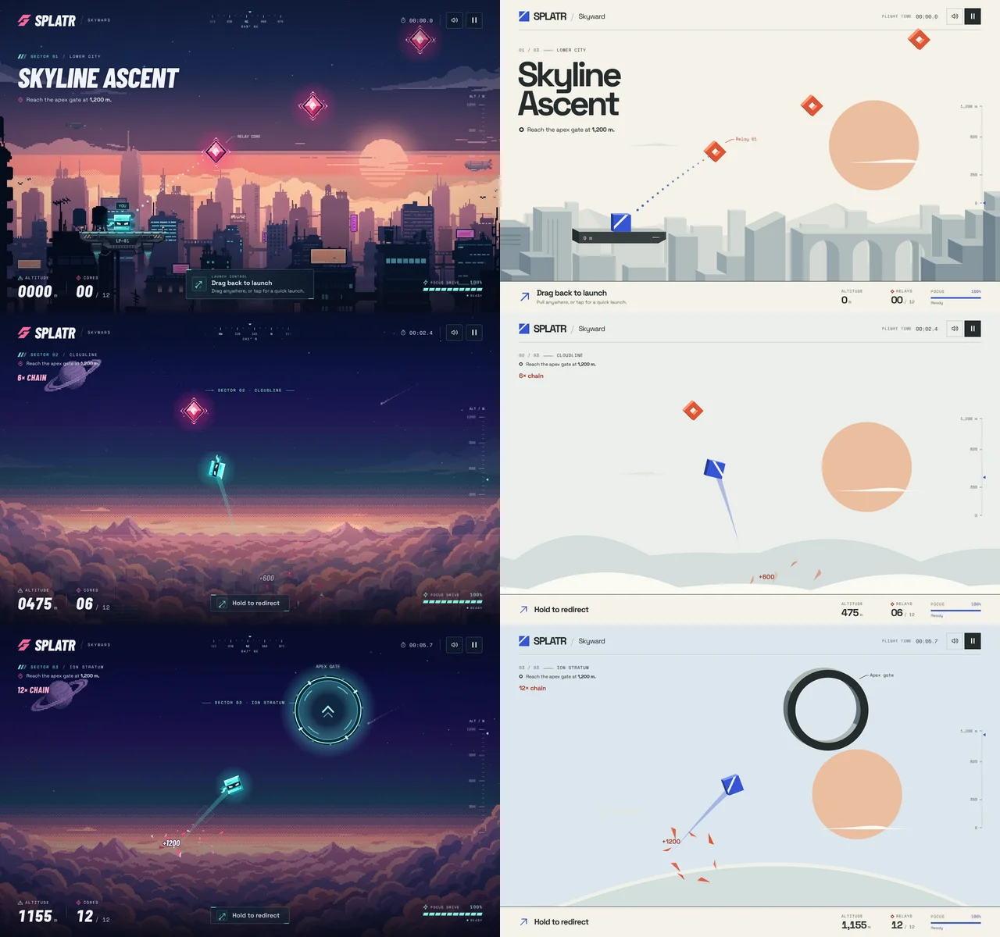

# Skyward · historical art audit

This audit records the previous summit-course iteration. The current game is **Shape Riot**; see [the current design notes](shape-riot.md).

**The test is whether you can read the next shot.** On a phone, find the pilot, the first optional relay and the predicted path without reading a label. At the summit, the opening you need to reach must be equally clear.

*Actual frames from the same 12-relay flight, at 0 m, 475 m and 1,155 m. Left is before; right is after. This comparison is documentation only.*

## What looked like “AI slop” here?

The two old landscape paintings were generated images. The cube, relays, effects and HUD were drawn in code. The problems below are visible design decisions, not a way to infer an asset’s authorship.

| Where | What wasn’t working | What changed in the game |
| --- | --- | --- |
| At the pad | Pink billboards and lit windows used the same attention-grabbing contrast as the pink pickups. Traffic and a second airship added motion without offering an action. | The city is now quiet blocks and one recognizable viaduct. Saturated cobalt belongs to the pilot and its actions; vermilion belongs to relays and their feedback. The sun is a muted, filled disk, never a hollow target. |
| Leaving the city | The sunset skyline dissolved into a different painting with a ringed planet. Mirroring the plates to cover horizontal travel could reverse landmarks. The climb looked like a change of wallpaper. | Buildings have fixed positions and move past the camera at different rates. Cloud banks overlap the receding city; the sky cools and a curved horizon emerges. The **same disk** stays in view. Crossing a named altitude changes a label, not the renderer. |
| Comparing objects | A visor and cloth tails, many crystal facets, riveted skids and a crest on the win screen implied four different sets of props. Small details disappeared at portrait scale. | Square with one slash, diamond with one cutout, circle with one opening. The architecture and actors extrude up-left at **2:1** with light from above-right, even as the pilot rotates. The win seal calls the **actual gate and pilot drawing functions**. |
| Breaking a relay | Orbiting sparks, a jewel halo, a shock ring, random chips and ghost cubes all said “impact.” Dotted route stitches also resembled the ballistic guide. | The diamond breaks into the **eight triangles that tile its front face**. The short hit-stop and chime carry the impact. One tapering ribbon shows where the pilot *was*; cobalt dots show where the shot *will go*. No decorative dotted route. |

## Keep the continuity

- **Use the shape before the label.** Only the launch plinth is solid. Scenery has lower contrast than the actors; clouds are continuous silhouettes, not floating slabs. A gate is open space bounded by a ring, not a bright filled orb.
- **Share construction, not just colours.** `src/art.js` owns the interaction palette, extrusion and relay mesh. HUD text uses the darker side inks. `src/scenery.js` draws actors directly at the current scale; do not add a separate trophy illustration or a high-altitude sprite set.
- **Check the transitions, not only the title frame.** Replay through 350 m and 820 m, reverse direction and recall. The sun must not duplicate or flip. Hold focus: a 50 m grid appears; on release it clears. A broken relay must not leave a platform behind.
- **Check at play size.** Compare 1280×800, 390×844 and short landscape. The portrait crop keeps the viaduct visible and moves callouts to the other side when needed. Pause and finish use the same paper, type and controls. With motion effects off, the shapes, ballistic guide, score and objective still communicate the game.
