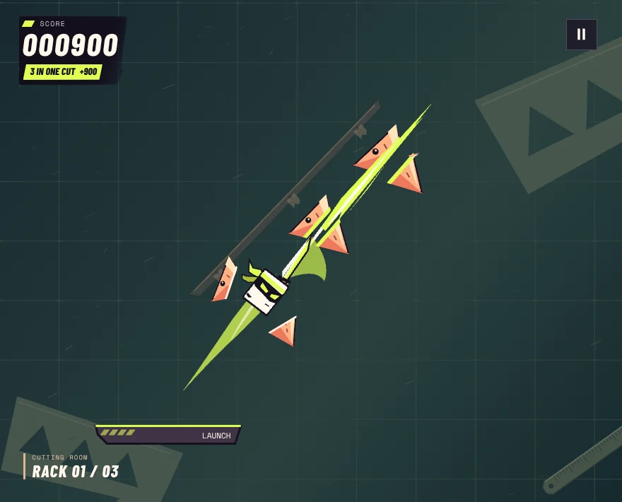
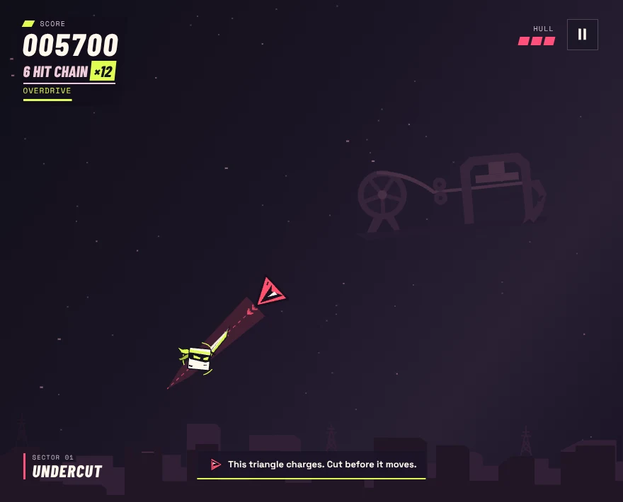
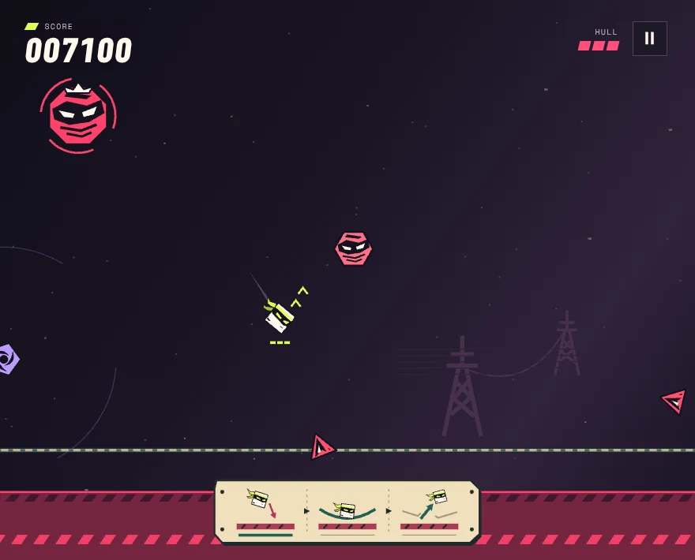

# The first four swings, and the guide that explains them

On seed 42 the old starting screen had seven enemies in view at 880 × 710, from five different families. One suggested dash followed by no input ended at the Redline on tick 130. That's about two seconds to work out what happened, pick a second target and learn that falling kills you. Another page in the manual wouldn't fix that.

**Start run** on a new save hangs three triangles on a rail. You can aim at the near one or the far one. Your longer blade can actually reach farther; the third triangle can be cut by the Throughcut released at the second. No enemy AI, shots or tide run in the room. A miss pulls you back to where you launched, without a score, a hit sound or a camera kick. The move you're on is drawn by the targets and the cube themselves. A small strip of three stamped miniatures under the cube shows cause and effect, follows the real event (a true first plate, the live lane, a real miss), and never presses anything. With reduced motion it holds one complete, static frame.

The second rack sits across the first stroke. The third holds a single bolted hexagon. The cube stops against the plate. It clacks, a strip flies off and a crack stays where the blade crossed. The score doesn't move. Hit it again and both halves fall away. Paper behaves differently: a dry rip and low slap, a gap on the first stopped frame, then light scraps that turn and slow in the air. With motion effects off the gaps and the crack remain. The shake and flutter don't.

Six kills buy real Overdrive. You keep the points, not just a “practice complete” message. One live Fang faces you across a red lane. Cut it or fly past. More triangles and shells join, but only one nearby attacker winds up at a time in sector one. Circles appear before diamonds; links wait until farther up. A cleared room gives you one safety net. It sits above the lethal stripe and gives you time to pick a shot if you fall. It doesn't respawn.

The room is spent by your **first Start**. A later run begins with the single live Fang, whether you finished the racks, skipped them, retired before the first swing or simply reloaded. For the old mixed opening, use **Options → Run opening → Full field**. **Gradual** keeps the single triangle on every run.

## Checks

- In 128 seeds, all three flags fit at 320 × 568, 844 × 390 and 880 × 710. The tests vary which flag gets aimed at. The clean four-swing route pays **900 → 2,100 → 2,100 → 5,700**. Waiting doesn't cost the chain on the bench. Three paid misses can empty the blade stock, but it recharges without a death.
- The built HTML was played with real mouse, keyboard and native touch events. The checks cover the miss and its marked retry, the crack without a kill, the first live lane, the first airborne focus, and the one-use net, then a later retry with no proof strip. Starting with a mouse and starting with the keyboard both show the matching input; a fresh save that is skipped, abandoned before the first swing or reloaded never replays the guide. The embedded preview test uses a scripts-only iframe with storage blocked: it plays the room with real input, then checks a retry in the same document goes straight to the field.
- The field around the rack was measured, not eyeballed: across 256 seeds the neatest ready target keeps at least 20.68 px from the left and 20.97 px from the right edge at 320 × 568, 14.17 px from the top and 201.53 px from either side at 880 × 710, and 7.78 px from the top at 844 × 390. The attacking field keeps a live, reachable target: in an explicit 48/60-tick decision simulation at 880 × 710 and 390 × 844, seven or eight of eight seeds never stalled.
- A simulated run from the cutting room on seed 42 reached sector 18 in 3,300 field ticks. All eight species appeared. The reference pointer run in the browser suite also clicks its way through 58 separate decisions to 211,120 points and three Throughcuts in eleven sectors, and the screenshot pass records the first live lane, the first airborne focus and the net.
- Attack telegraphs are longer, but a committed move is still meant to be read, not memorized. A wind-up lasts 66 to 90 simulation ticks depending on the species, plus 24 in the gentler opening sectors, and a starting attack is spaced from the previous one. The full browser suite plays the first net, focus and the live lane with real events; it does not prove that every future player will read every tell.

The [earlier feel audit](throughcut.md) is why an empty swing gets a whoosh, but no thud or freeze. The tests check what happens, not how much anyone likes it. The next useful observation is a first-time player with sound off: after cracking the shell, do they swing again without looking away from it?
