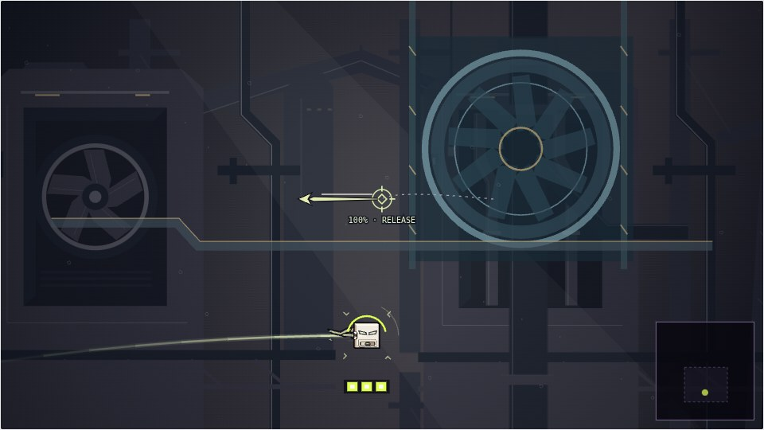
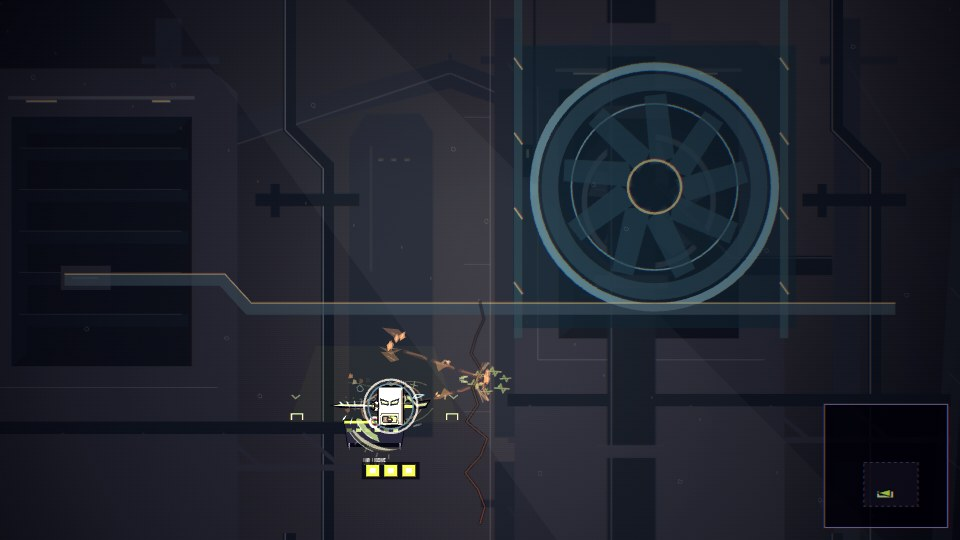
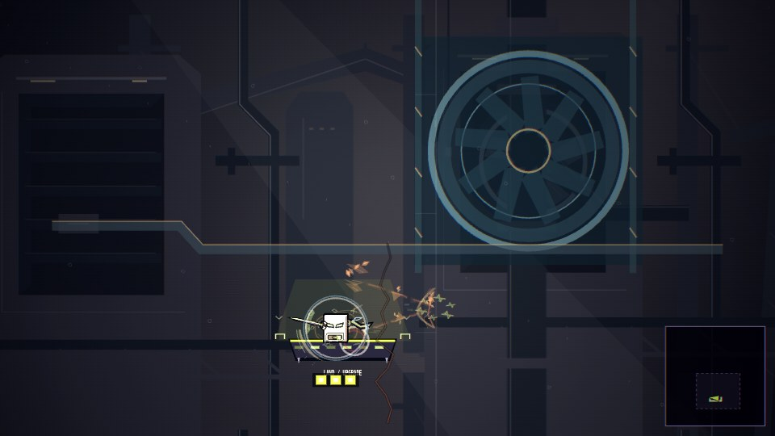

# Inverted drag, responsive rebounds and contact morphing

This pass **replaces** the previous desktop hold-to-charge/direct-aim experiment. It does not pretend the last control model was the solution the player wanted.

## Controls now

| Action | Result |
| --- | --- |
| Left press, drag right, release | Launch left |
| Left press, drag down, release | Launch up |
| Pull farther | More requested launch power, up to full |
| Hold without pulling | No charge and no shot on release |
| Return to the small, visible origin ring | Cancel; pulling out again re-arms |
| Right-click or Escape while pulling | Cancel; a later left release cannot fire |
| **Shift + left click** | Explicit point-and-shoot shortcut at normal power |

The mode is fixed **when pressing**, not when the cursor crosses an invisible distance threshold. A plain left drag can never silently turn into a direct shot. Shift+click can never silently turn into a reverse spring. The six-pixel spring slack has zero output and a visible ring; beyond it, power rises continuously from zero instead of jumping to the old 28% minimum. More holding time does not change power.

The tether connects the press point to the real cursor. The arrow points the other way and morphs with the equipped arrow style and requested power. The in-world ballistic sight and release use the same input pipeline. Cursor capture, off-canvas release, camera-independent pull direction, right-click/Escape/blur/resize cancellation and stale-request cleanup remain in place.

**Important:** power is requested launch strength, not a promise to delete existing momentum. The game's stored-speed steering, optional assistance, opening safety adjustment, recovery and Edge rules still apply. Full pull reaches full-power precision equipment. Keyboard controls remain available. Touch retains its previous tap/pull behavior; touch's tap gesture was not removed.

Practice and teaching now project canvas-local coordinates exactly once, fixing their extra canvas-offset subtraction. Opening, tutorial, practice, teaching and accessibility copy describe the new desktop contract.

## Bounce mechanics changed—not only the particles

### Preserve the arrival angle

A side wall used to write `min(incomingY, -4)`. A downward arrival at 30 became an upward exit at -4, no matter how steeply the player approached. It felt like the wall was choosing a new move.

The side rail now keeps its established **85% horizontal retention** and uses a small lift while preserving a downward tangent: `incomingY × 0.96 − 4` for falling arrivals. A flat arrival still gets the small upward hop; an already rising arrival is not given extra upward acceleration. For example, downward 30 becomes downward 24.8 at the physics reflection, rather than upward -4. Existing earned-bank bonuses and flight limits still apply afterward.

### Debounce rewards, not physical escape

Previously, hitting a recently touched side wall could clamp the player while refusing to reflect their outward velocity. The ignore window now suppresses duplicate **contact/reward publication**, not the physical rebound. A second genuine arrival reflects inward without publishing another reward contact.

Corner normals are normalized. Absolute speed bounds, upright physics, the floor's rescue trampoline, bank anti-farming and existing build bonuses remain intact. No extra Edge refill, health or damage was added to make bouncing look successful.

## Morphing response

The renderer receives **measured incoming and outgoing velocity** on real physics bank receipts. The new bounded effect uses those values:

1. A wall-aligned compressed ribbon blossoms inward from the contact.
2. Three continuous folds bend toward the actual exit tangent.
3. A rounded-square material contour blends into a flowing spindle around the moving player, then relaxes.
4. The body compresses and recovers without rotating its physics body.

The color/material follows the equipped dash. Existing elemental particles and power-specific animations remain; this is an additional contact-to-flight transition, not their replacement. There are at most six wall imprints, each expiring after 48 simulation ticks. Stopped simulation does not age them. Reduced motion clears the new morph; PostFX Off still allows ordinary Canvas effects without requiring WebGL.

### A visual defect caught during this pass

The first inspected wall frames still made the character paper-thin: the legacy pancake, impact squeeze and travel stretch were multiplying. Fixing only the first bank's impact ownership did not cover a later contact during its cooldown. The final body painter now clamps the **composed** deformation, including splats, to **0.80–1.25 per axis**. A real-run rendering regression and every captured bounce frame check that final envelope. It is not sufficient to test each animation layer's bounds independently.

Early compression, then settling folds (controlled real-physics fixture):

## Normal production-build playtest

The normal **Start Run** flow is exercised against the built single-file game—not an input-only fixture. The script uses real mouse/Shift events, reads debug state, and seeds only tutorial-completion, motion and PostFX preferences. It does not inject run state, actors, health, resources or renderer state.

It checks stationary hold, inverted horizontal/vertical pulls, return-to-origin cancellation, right-button cancellation, Escape cancellation and Shift+click. Every launching action must add exactly one shot; every cancellation must add none. The held label, release cleanup, pause-dialog state, visible PostFX output and unchanged equipment save are checked.

[Latest ordinary gameplay recording](play/gameplay.webm) · [Exact results](play/results.json)

The video is Canvas-only; screenshots include DOM HUD and the local pull cue. The latest observations and test totals are in [validation.json](validation.json).

## Honest remaining critique

- This is now a consistent inverted spring, **not** another attempt to make every gesture mean everything. The deliberate cost is that an unmodified stationary mouse click no longer shoots. Shift+click is the explicit shortcut.
- Momentum and leading moving targets remain skills. This pass does not auto-hit a target, flatten all trajectories into laser lines, or certify that every player will prefer the response curve.
- The HUD still competes with the action at 960×540. In the held-pull screenshot, the bottom teaching strip crowds the actor. This pass does not claim that broader hierarchy problem is solved.
- The new wall folds are intentionally local. More fullscreen rings would hide the direction change, not explain it.
- Browser automation plus screenshot inspection is not a human usability study. Software WebGL output is not a hardware FPS or input-latency benchmark.

## Reproduce

- `npm test`
- `npm run build`
- `LD_LIBRARY_PATH=/tmp/al2023/lib node scripts/pc-controls-browser-qa.mjs`
- `LD_LIBRARY_PATH=/tmp/al2023/lib node scripts/rebound-morph-browser-qa.mjs`
- `PREVIEW_URL=http://127.0.0.1:5202 LD_LIBRARY_PATH=/tmp/al2023/lib node scripts/pc-controls-play-qa.mjs`

The first two browser scripts use a dev server on port 5201 and controlled fixtures. The last uses the built preview on port 5202 and ordinary progression. Chromium defaults to `/tmp/chromium`; set `CHROMIUM` to use a different installation. Earlier direct-aim results under `docs/pc-controls/` are historical, not the current acceptance criteria. No commit or push.

## Final validation

- **1,538/1,538** full-suite tests passed, zero failures/cancellations/skips.
- **84/84** final focused regressions passed.
- **20/20** real-browser inverted-input cases passed.
- **25/25** actual-physics rebound/morph browser frames passed, including reduced motion and PostFX Off; all final body envelopes bounded.
- **7/7** normal production Start Run interaction cases passed. The latest short recording ends at four shots, zero kills, 3 HP and an ongoing run, with no frame/page errors. It is a controls check, not proof of effortless targeting.
- Production single-file build: **1,342.2 KiB**, gzip **494.88 kB**. Diff check passed.

The full suite also caught a draw-derived diagnostic leaking into fixed-update effect state; the body-pose diagnostic is now separate, so drawing does not age/change effect state. The old pixel test demanded a below-55% wall pancake; it now checks visible compression **within** the new readable envelope rather than preserving the paper-thin behavior the screenshots exposed.
