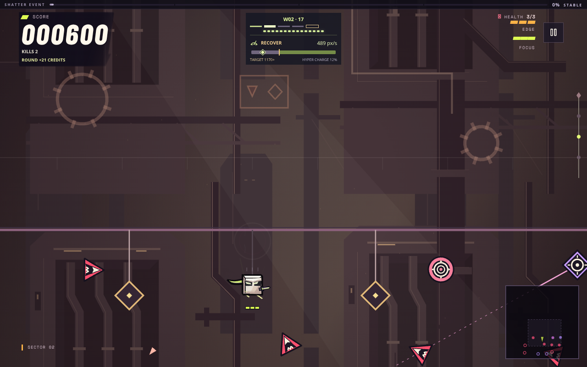
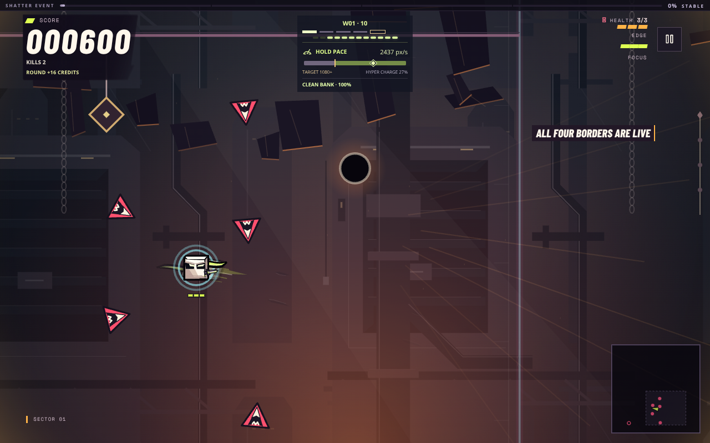
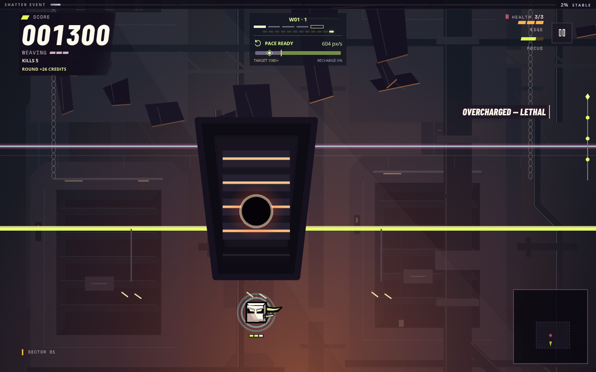
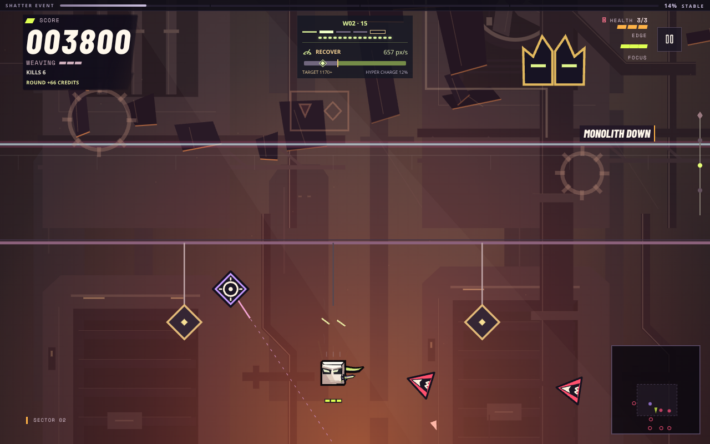
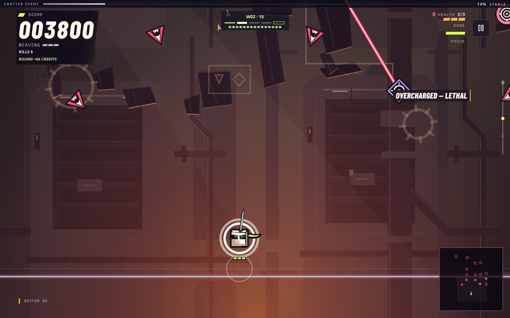

# THE MONOLITH — CHUNK 4

The reserved Chunk 4 of the Fracture / SHATTERED arc, delivered. In an
ordinary arena the fifth clear (or a completed sector) opens the way onward.
In a **torn** arena it does not. The tear has a landlord. When you come
through the seam with the world already broken, the seam answers.

|                     | Before                                 | After                                  |
| ------------------- | -------------------------------------- | -------------------------------------- |
| Torn field, seam    | crosses freely, sector advances        | seals the crossing — **THE MONOLITH** seats |
| Ordinary clear #5   | Dimension Breach opens                  | unchanged — the breach still opens      |
| Cutting it          | n/a                                    | only a banked **OVERCHARGED** cut takes a plate |
| Closing it          | n/a                                    | +12 FRACTURE tribute, the seam opens    |

## 1. What it is

One enemy. `kind: 'monolith'` in the shape table
(`src/art/splatr-art-engine.js`, `var TYPES`):

| property  | value                                            |
| --------- | ------------------------------------------------ |
| shape     | slab (trapezoid), near-black `#0d0b13`             |
| radius    | 215 — enlarged for 6B                            |
| points    | 2500                                             |
| hp        | 10 — **five plates, two health each**            |
| credits   | 25 (`ENEMY_CREDITS`)                              |

Five slab seams are drawn as lamps: live plates burn amber, fallen plates go
dark, and the core ember brightens as the face falls. It is drawn at module
scope in the art engine (`foe()`, case `'monolith'`) — no per-frame closures,
the same discipline every enemy in the catalog keeps.

## 2. Where it seats — both directors

The game has two field directors, and the Monolith answers in both.

### Continuous sectors (`src/continuous-sectors.js`) — the browser build

This is the mode the shipped game actually plays. Each sector raises three
anchor locks and a crossing seal. In a SHATTERED arena:

1. Breaking the **third lock** with the seal ready seats the Monolith in the
   seam at once: the field is swept, ordinary enemies cleared, and one pinned
   `monolith/core` slab is placed up the corridor (`seal.x`, ~340px above the
   seal line — on the line the crossing dash rides).
2. The seam crossing is **void while it stands** — no sector advance, no
   arena lift, no silent sweep (the regression that made the manifest
   invisible in the first live build).
3. When the Monolith falls, the sector seam **opens itself**: `dimensionBreak`
   + `sector` events fire exactly as an ordinary crossing would, the arena
   lifts 1000px, and Sector 02 begins. The fall is checked unconditionally at
   the top of the director tick, so it opens the seam even if the killing cut
   spent the blade.

In an ordinary arena nothing changes: break the locks, cross upward, the seam
opens the way it always did.

### Wave director (`src/waves.js`)

The every-fifth clear in a SHATTERED arena no longer opens a Dimension
Breach — it manifests the Monolith instead (pinned, `hp:10`, armed at the
arena center, 30% down from the top edge). Ordinary arenas and control
practice keep the breach exactly as it was. When it falls, the ordinary
end-of-wave ritual follows: `rest()`, the rest deck rises. Wave mode is not
the browser build, but the rule is kept honest there too.

## 3. The one key — and the wall

`src/run.js`, in `cut()`:

- A cut **below** stage 4 (OVERCHARGED) chips **1 hp**. Crown kits, armor
  plates, momentum — nothing dents it. Ten ordinary cuts still fell it: it is
  a wall, not a lockout.
- A cut at **stage 4** — the OVERCHARGED, lethal bank a SHATTERED arena can
  build from its borders — takes a **whole plate**: 2 hp, seam by seam.
  (Five plates. In the wave-mode path this rule is the same one table.)
- Kinetic stage reads ×4 only in SHATTERED (`kin` is the SHATTERED-clamped
  ladder, capped 4) — the tear is the key.

Design intent: the SHATTERED arena's rail/charge game stops being dressing on
the world after the tear and becomes the price of the next sector — the boss
is *fastest* by banking the borders and cutting at OVERCHARGED. Chips alone
still work (ten ordinary cuts fell it, as `test/chunk4.test.js` measures):
the rails make it quick; the wall makes it possible.

## 4. The landlord acts (6B)

The seated slab is a pinned combat actor, not a decorative door. Its clocks
run in simulation ticks and pause with the rest of the fight:

- **SEISMIC LASH** resolves every 360 ticks. Four gravity-bearing debris arcs
  are telegraphed for 54 ticks, then each can cost one hull and can be parried
  by a live blade.
- **PLATE SLAM** resolves every 270 ticks while at least three plates remain.
  The lowest live seam tells for 30 ticks, then a 150px shockwave shoves an
  unguarded player 220px radially and holds steering for 21 ticks. A live blade
  or parry window walks through it without damage.
- **GRAVITY LENS** resolves every 540 ticks. Its 45-tick tell opens a 90-tick
  pull at 2.1px/tick² toward the slab; cuts that connect during that window
  receive the extra point of plate damage.

The bottom-center boss bar projects `ceil(hp / 2)` into five accessible cells.
It updates only when the plate count changes, hides when the pinned actor falls,
and removes all hazards sourced by the slab on cleanup. The enlarged wave arena
is `3200×2600`, `x:-1600`, `y:-2300`, with its floor held at `+300`; continuous
sector lifts are `1000` world pixels.

## 5. The tribute (meter tie-in)

Felling the Monolith pays `FRACTURE_PER_MONOLITH = 12` (the largest single
fracture gain in the game besides the tear itself), emits `monolithDown`
(`MAIN` shell: `audio.strike('drive')`, heavy buzz, "The Monolith falls.",
`MONOLITH DOWN` pop), increments the per-run `s.monoliths` counter, and pays
the kill ledger reward (25 credits). It does **not** re-spend or re-credit
the tear — `consumeFracture`'s one-time semantics are untouched.

Because the kill happens outside the armor branch, the fall path pays out
through the ordinary cut tail: kill count, `FRACTURE_PER_KILL` for the cut
that finished it, points (2500), ledger credit.

## 6. Live evidence (`qa-browser/chunk4-qa.mjs`, preview :5173)

Both passes played the **live browser build** headless-Chromium against the
production bundle, driving real dashes through real locks and the seam:

**BEFORE** — ordinary arena, the fifth clear, the seam opens, sector 2 begins:



**AFTER** — the same run in a torn arena. The tear scar stands above the
cube, the locks fall the same way, the crossing opens nothing — and the
landlord stands in the seam:




Five banked OVERCHARGED cuts (kinetic 4 forced at the dash, stage consumed
per plate) bring it down. `MONOLITH DOWN`, 14.4% STABLE on the ribbon (+12
tribute on top of the tear's 0% and the sector clears), Sector 02 begins:




QA log (abbreviated):

```
A after:    {"sector":2,"arenaY":-2565,"monolith":false}            // ordinary seam opens
B monolith: {"sector":1,"monolith":true,"monolithEnemy":{"hp":8}}   // seats, manifest dash clipped once
B cut 4:    {"sector":2,"monoliths":1,"pct":14.4}                   // the fall pays the tribute
errors: []                                                          // zero page errors, both passes
```

Known cosmetic: the ribbon's `.fracture-pct`/`.fracture-tier` render with a
gap (flex `gap:8px`); their raw `textContent` concatenates as `14%STABLE`,
which is what the QA `hud` string shows. It is not a layout bug — the
screenshots show the spacing. (Earlier note said "missing space"; that was a
phantom of text extraction, not of CSS.)

## 7. Tests — `test/chunk4.test.js` (10/10)

- TYPES.monolith exists (r 215, points 2500); `FRACTURE_PER_MONOLITH` is 12.
- Fifth clear in SHATTERED (wave mode) manifests the pinned slab, not the
  breach; the same clear elsewhere opens the ordinary breach (regression);
  control practice manifests nothing.
- Ordinary cut chips 1; stage-2 and stage-3 cuts chip 1; OVERCHARGED takes
  2 hp (one plate) and spends the ladder back to ×1.
- Five OVERCHARGED cuts fell it; +12 tribute lands (plus kill feed and
  wave-clear seams — asserted against the constants, not a magic number);
  `monolithDown` emitted; the rest deck rises.
- Ten ordinary cuts still fell it — a wall, not a lockout.
- A fresh run boots clean (no stray monolith state).
- **Continuous sectors, the live mode:** a torn arena seats the Monolith at
  the seam; the crossing is void while it stands; five banked OVERCHARGED
  cuts fell it; `dimensionBreak` + `sector` fire; the arena lifts 1000px;
  Sector 02 begins.

The current repository suite covers the original checks plus the focused 6A,
6B and provisional 6C tests. The wave-mode
`run.test.js` kind-count assertion now expects `SPECIES.length - 1` with a
comment: a long ordinary run never meets the Monolith by design — the
Monolith only manifests on a SHATTERED fifth-clear / sector seam.

## 8. Not done / not claimed

- No hit animation for the fall beyond the existing `flash`/pop; the Monolith
  does not speak, phase, or enrage — it is a door, and doors do not.
- No dedicated sound beyond `audio.shatter()` (rise) and `audio.strike('drive')`
  (fall).
- The `s.stop` hitstop on each plate hit is the generic pinned-armor value
  (5 ticks), not a bespoke slam.
- No persistence of `s.monoliths` to storage or the RUN ENDED debrief yet —
  it is a per-run counter rendered nowhere.
- Commit/push deliberately not done (branch policy).
