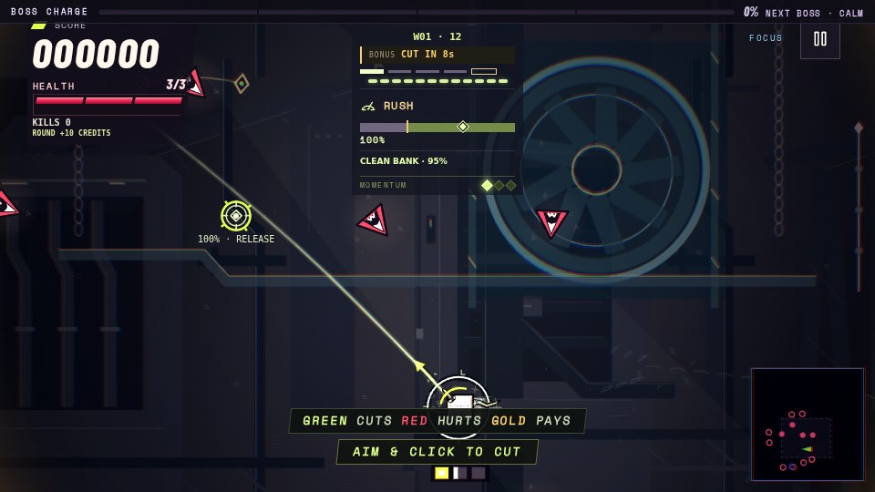
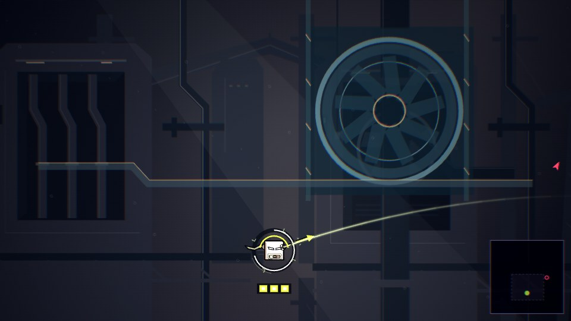
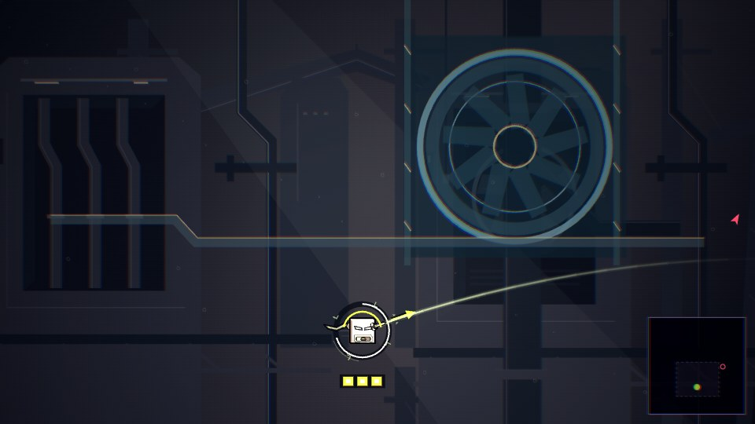

# PC controls: player-perspective review and roast

> **Historical pass, superseded:** desktop controls were inverted again at the player’s request. See [the current inverted-controls review](../inverted-controls/review.md). The browser scripts now exercise that new contract; the captures and numbers below describe this earlier direct-aim experiment.

## The blunt verdict

**The old mouse model was a touch slingshot wearing a mouse cursor.** The problem was not a lack of particles. Two incompatible meanings lived on the same left-button interaction, separated by an invisible movement threshold.

This review distinguishes reproducible browser observations, source-level findings and subjective judgement. It is automated player-perspective testing plus screenshot inspection, not a study with human participants or a real-device latency benchmark.

## What actually went wrong

### 1. Two extra pixels could change the entire shot

The controlled **before** browser test pressed at `(680,250)` and used real Puppeteer mouse events against `createInput` connected to the real run and renderer:

| Gesture | Observed preview vector | Shot speed | Interpretation |
| --- | --- | --- | --- |
| Stationary press | `(6.089, -31.110)` | 31.7 | Aim upward toward the pressed world point |
| Move right 7 px | `(6.089, -31.110)` | 31.7 | Still the original target tap |
| Move right 9 px | `(-11.864, 0)` | 11.864 | Suddenly a weak leftward pull shot |
| Drag to `(920,190)` | `(-40.746, 10.186)` | 42 | Aiming toward the new cursor instead becomes a reverse slingshot |
| Return to original press position after dragging | No vector; no shot | — | Silently canceled |

For this setup, crossing from 7 to 9 pixels rotated the launch by about **101 degrees** and reduced its speed by about **63%**. That is not precision. That is a trap for anyone who moves the mouse while clicking.

The old preview usually matched the old computed command. That does **not** make the interaction good: faithfully previewing a surprising input contract is still a bad PC contract.

Evidence: `before/controls.json` and the three before screenshots. These are controlled measurements, not ordinary progression.

### 2. Moving the mouse to another target was not a reliable way to retarget

A small movement kept the press-time world point/target. A larger movement changed to a vector opposite the press delta. Neither was the natural desktop meaning of “I am holding aim and moving my cursor over there.” The world-anchor retention had a reasonable purpose for touch taps during camera motion; using that same rule for desktop was the wrong abstraction.

### 3. Cancellation was too clever where it should have been boring

Returning a latched pull inside a tiny inner ring canceled it. Good as an intentional touch escape, poor as an undocumented mouse correction rule.

The isolated before-input test also showed no owned Escape cancellation and no right-button-chord cancellation: its later left-button release still committed. In the full game, Escape was handled by the global pause path; do not misread the isolated result as proof that Escape always launched in ordinary play. The issue was inconsistent ownership and no simple “cancel this aim, stay in the fight” desktop action.

### 4. A separate main-loop integration bug was hiding in plain sight

`createInput.tick()` already implemented held keyboard rotation, but ordinary `main.js` called `retry()` and read `aim` without calling that update. Practice/teaching had their own update calls. A control working in a practice surface does not prove it is wired into the main game.

The main loop now calls the input update before setting the run's aim. This also updates the stationary mouse power readout while holding.

## The new PC contract

- **Point and click:** a quick click retains the previous normal tap speed, 31.7 out of the 42 launch cap (about 75%).
- **Hold and move:** the solution follows the current cursor position, reprojected through the current camera. There is no mouse-distance threshold that changes direction or switches to slingshot mode.
- **Hold for power:** after a 120 ms click grace, power rises smoothly over 280 ms to full power. The held pointer displays actual power and RELEASE. Full-power precision items remain reachable on mouse; the fix did not accidentally strand Sniper behind a removed drag gesture.
- **Release:** uses the same live aiming pipeline, including visible ballistic lead and optional assistance. Moving the cursor is not a promise to teleport through a moving target or ignore momentum.
- **Cancel:** right mouse button while holding left, or Escape while holding. The later left release cannot launch. Escape without a captured aim still reaches normal pause handling.
- **Safety:** off-canvas release works; lost capture, blur, resize and inactive release cancel. New mouse intent/cancellation clears a previous unspent near-reload request, not the player's velocity or resources.
- **Touch:** tap/pull-back behavior, hysteresis, return-to-origin cancellation, variable pull power, off-canvas handling, reload buffer and momentum guarantees remain explicitly tested as touch behavior.

**Tradeoff, not hidden:** desktop now offers normal-to-full held power, not the old very-low-power short mouse pulls. That removes a confusing mode switch at the cost of low-strength mouse slingshots. A dedicated fine-power binding would need a separate deliberate design if that becomes a core PC skill; it should not sneak back in as an 8-pixel reversal.

## Chromatic pass: stronger without sabotaging input

The earlier offset was multiplied by the peripheral/protection mask, then the blend was attenuated by the same mask again. That made much of the effect disappear. Backing-buffer pixels were also treated as display pixels, so a budget-scaled large canvas did not have the same apparent optical strength.

The new pass:

- Raises the idle split to 0.7 and adds stronger focus, real release and live-chain envelopes, bounded to a **3.2 CSS-pixel sample distance** including the shared blur offset.
- Uses one spatial gate and edge-aware dispersion rather than blurring flat color everywhere.
- Leans the dispersion toward actual travel direction at speed; no invented movement or shot success.
- Converts the offset from display pixels to backing pixels, so render-budget scaling does not inflate the fringe.
- Retains actor masks, the aim corridor, bright-pixel protection and red/pink danger protection. Red warning pixels found in adjacent samples also suppress bleed.
- Keeps exactly three texture reads, one pass, no framebuffer chain, no shader loop. Baseline blur was not increased.
- Keeps Off/Auto fallback, context handling and reduced motion. Reduced motion has zero new split, blur, travel distortion or grain. DOM HUD and pointer readout remain outside the shader.

Screenshot inspection: the fan rims and industrial background edges carry the stronger color separation, while the player and aim line remain substantially sharper. This is peripheral lens treatment, not a deliberate RGB ghost over every enemy. The canvas minimap is still part of the graded scene, unlike DOM HUD.

## Normal-play review: the remaining roast

I opened **Start Run**, with the ordinary free build, and drove the same live game a player gets. This is a short scripted playtest with inspected screenshots—not a claim of human testing.

- **The mouse finally has one meaning.** The normal run accepted click, small-movement, retarget and charged releases as one shot each. Right-click and Escape canceled without opening a pause dialog or spending another shot. The visible held cue reached `100% · RELEASE`; release cleared it. PostFX was visibly presenting, not just allocated in memory.
- **It is still possible to aim competently and hit nothing.** The final short recording ends at five shots, zero kills and an ongoing run. That is not dressed up as “combat mastered.” A moving target, momentum and selecting a location before holding all matter. Fixing the backwards gesture does not guarantee a cut. Longer human play should decide whether normal quick-click speed and lead assistance need further tuning.
- **The HUD still looks like several dashboards fighting over one windscreen.** Boss charge, score, health, wave bonus, Rush, momentum, Edge and the bottom teaching strips all compete. At 960×540 the bottom actor/resources can crowd the instructional strip. The new power cue is local to the pointer, but it does not cure the broader hierarchy problem.
- **The giant fan is better at advertising the new lens than the combat is.** Its clean blue/red rims visibly prove the stronger split. That is good for atmosphere, but a background prop should not become the star during a target decision. I kept actor/aim protection instead of cranking the whole screen into three misregistered copies.
- **Readable is not the same as effortless.** The aim line is sharp and the power label survives grading, but actors remain small amid ornate industrial framing. More particles would not solve that. A later pass should reduce competing HUD emphasis during aiming and test target acquisition with real PC players.

### Inspect the actual output

Normal Start Run, held retarget—DOM power cue and protected aim line:

Same controlled focus scene, before the stronger lens:

After—stronger fan/background rims, protected player and aim corridor:

[Ordinary gameplay recording, canvas only](play/pc-gameplay.webm) · [Exact normal-run observations](play/results.json)

## What this does NOT magically solve

- Momentum, leading moving targets and finite blade duration can still make an apparently well-directed shot miss. Reversing the wrong input is fixed; overshoot is not automatically a bug.
- Empty Edge, recovery, stun and phase restrictions can still refuse or buffer a shot. The bounded input retry and near-reload queue remain; resources are not fabricated to make a test pass.
- Assist can visibly favor a nearer plate in the corridor. A cursor is an aiming request, not immunity from occlusion or a guaranteed target kill.
- Small actors and busy UI can still compete with the background. More chromatic separation is not a substitute for hierarchy.
- Touch's tiny cancellation region was not redesigned in this PC pass.
- Software-GPU browser timing is not evidence about a user's hardware FPS or input latency.

## Review discipline / evidence

- `scripts/pc-controls-browser-qa.mjs`: nine before observations and ten after scenarios, with actual browser events and the real input/run/renderer seam. After coverage adds explicit camera-pan reprojection. No simulation clock advances while comparing fully charged preview and release. This is a controlled fixture, not ordinary play.
- `scripts/combat-lens-browser-qa.mjs`: old/new full-resolution WebGL matrix in `lens-before/` and `lens-after/`. Both cover desktop/portrait, motion/reduced, Off/idle/focus/release/native-earned-chain. Same deterministic setup, actual output screenshots.
- `scripts/pc-controls-play-qa.mjs`: normal free-equipment Start Run, pointer clicks, small drag, retarget, right-button cancel, Escape cancel and a full hold/release. Debug/trace reads only; no actor, health, charge, run-state or renderer injection. Actual WebGL output video and screenshots; screenshots include the DOM pointer cue, canvas video does not.
- The first normal Start Run attempt caught an invalid help pictogram introduced during this pass. It prevented bootstrap despite isolated input tests passing. Replaced it with the existing clock icon and added a real help-UI construction regression. This is exactly why a code-level input test is not a substitute for opening the game.
- Early normal-run assertions also sampled the game before its first playing frame had presented: an allocated WebGL context is not proof of visible output. The fixture now waits for the PostFX canvas to be visible **and** the source to be hidden before recording. This was a test synchronization fix, not a claim of a renderer failure.
- A 1280-pixel software-GPU debug capture stalled during cleanup; its process was stopped. The final ordinary-play fixture uses a 960×540 desktop viewport; controlled pointer rendering is 1280×720. No performance claim is based on that debug stall.

**Final validation:** 1,527/1,527 full tests, 75/75 focused tests, 10/10 desktop browser cases, 20/20 enhanced-lens WebGL scenarios, six ordinary Start Run interaction cases, production single-file build (1,337.3 KiB) and diff check pass. Exact results and limitations are recorded in `validation.json`. No commit or push.
