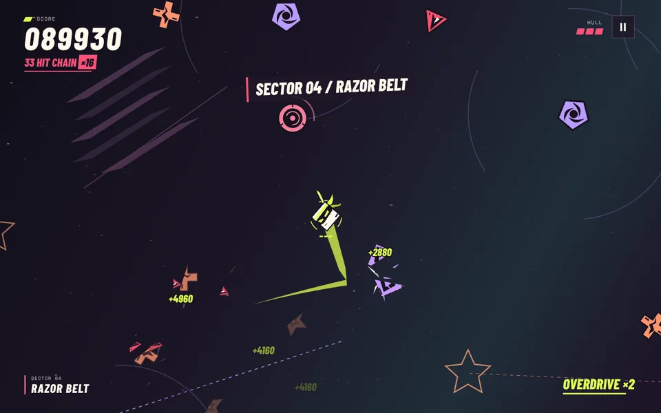

# Designing Shape Riot

**The title shows the move you are about to make.** The scarfed square cuts through two shapes on a torn poster and the stroke carries through a plated Bastion. The score is the objective. There is no route checklist, summit or time-to-finish target. For the current build, see **[Throughcut: art, UI, juice and the decision behind the new move](throughcut.md)**.

*Historical browser frame from the first Shape Riot pass. The later pass kept the directional fractures but removed floating score labels.*

## Research → specific decisions

| Question | Evidence and its limits | Decision in this game |
| --- | --- | --- |
| What belongs first on the title, pause and results screens? | Sears & Shneiderman, *Split menus: Effectively using selection frequency to organize menus* (1993): two field studies and a controlled experiment found benefits to putting frequent choices first. These were ordinary selection menus, not game title screens; short menus may already work well. [1](https://api.drum.lib.umd.edu/server/api/core/bitstreams/f53cafcd-2b8d-46d0-a8fe-87420f708f72/content) | **Start run / Resume run / New run** are stable primary actions. Enter activates the default; a descriptive label accompanies each action. The menu never reorders itself based on previous clicks. End run is separate from Resume. |
| How does a player get back from a setting? | Kathryn Theisen's game-menu usability thesis project (2022–23) compared *Super Smash Bros. for Wii U* flows with a prototype using think-aloud interviews and questionnaires. Participants described problems finding settings; shortcuts, clear feedback and hubs were useful in that case. [2](https://www.kathryntheisen.com/researching-and-testing-the-ux-of-settings-menus) | The same one-level **Options** and **Field manual** are reachable from the title and pause. Settings say On/Off immediately. Back returns to the place you came from; it never launches or discards a run. |
| Which numbers need to follow the player? | Peacocke, Teather & Carette, *Performance of HUDs and Diegetic Displays in FPS Games* (2015), compared five ammo indicators with ten weekly FPS players. Weapon-adjacent numbers did better than corner numbers for shots attempted after empty; reload time did not differ significantly by display. This was not a 2D dash-charge test. [3](https://www.csit.carleton.ca/~rteather/pdfs/GI2015_poster2.pdf) | Put the **three cut pips under the cube** and the focus arc beside it. Put a sight line on the aiming Prism and the blink outline at the Rift's destination. Keep score, hull and the longer-term sector label at the edges. |
| What should a successful cut feel like? | Lin et al., *What Features Influence Impact Feel?* (2022), analyzed player comments and compared impact features in higher- and lower-ranked action games. They identified sound coherence, hit-stop and camera control as candidates, not a universally optimal shake intensity. [4](https://arxiv.org/abs/2208.06155) | Use **two pieces clipped from the struck silhouette**. Cracking armor sounds different and doesn't pay out a kill. The Throughcut pass tiers the stop and sound by material and moves stroke awards next to the score. Motion effects can be switched off without changing hits or scoring. |

These are design adaptations. We tested the implementation and screen layouts, not human retention, enjoyment, reaction time or a predicted percentage improvement.

## Art and mechanical references

- **Dani:** [*Fair n Square*](https://danidev.itch.io/fair-n-square) is a concrete reference from Dani's catalogue: a 2D square shooter with physics and a health-for-upgrades decision. The brief didn't identify a single title. The influence here is a square protagonist, immediately legible movement and a risk worth taking: cut another target for chain and charge, or spend a charge getting above the Redline. Shape Riot has its own controls, art, levels, score system and sound; it is not a port of that shooter.
- **Silhouette before detail:** Mitchell, Francke & Eng describe designing characters that read by silhouette in *Illustrative Rendering in Team Fortress 2* (2007). [5](https://steamcdn-a.akamaihd.net/apps/valve/2007/NPAR07_IllustrativeRenderingInTeamFortress2.pdf) This is an art-production reference, not a controlled UI study. Here the shield, seam, scope and vortex marks sit **inside different outlines**. A colour-blind player needn't distinguish two shades of pink to tell a charging triangle from a shock ring. The art uses no perspective, extrusion, lighting simulation or 3D scene.
- **Two inks for two jobs:** acid yellow marks the player's affordances (blade, prospective path, charges, primary action). Hot pink/lilac/orange mark threats. Broken aerials, resonators and the press use darker inks in play than on the title. In a crowded sector, a dashed sight line becomes a solid attack; hue is not its only cue.
- **A moving camera is not a bigger texture:** the renderer samples an interpolated view of a streamed field. Fixed ticks drive combat; render time blends body, enemy, hazard, camera and fragment poses. This follows the accumulator/interpolation distinction in Fiedler's [*Fix Your Timestep!*](https://gafferongames.com/post/fix_your_timestep/). It doesn't imply a particular frame rate on every device.

## Check at play size

1. Start without reading the manual. On both a phone and a desktop the two notched one-plate targets and dotted opening trajectory should be visible. Try a second run: the opening can face the other way and the following formation can be different.
2. Hold airborne, change direction, and compare a cut, an armor crack and a hull hit. The first restores a pip, the second keeps the enemy alive, and the third clears the chain. A quiet or reduced-motion run must communicate all three outcomes.
3. In a crossfire cell, trace the link to its two living endpoints. Cutting one must remove the beam. In a hunter sector, the octagonal Crown should read differently from an ordinary armored hexagon.
4. Pause mid-gesture, inspect a specimen, rotate, and resume. No shot should fire on release of the old gesture. In short landscape the manual and run report use two columns; a narrow portrait panel can scroll without moving the arena.
5. Let the tide catch the cube. Read the cause and counter on the result screen. New run starts at zero on a new seed; the personal best survives a reload when local storage works.
