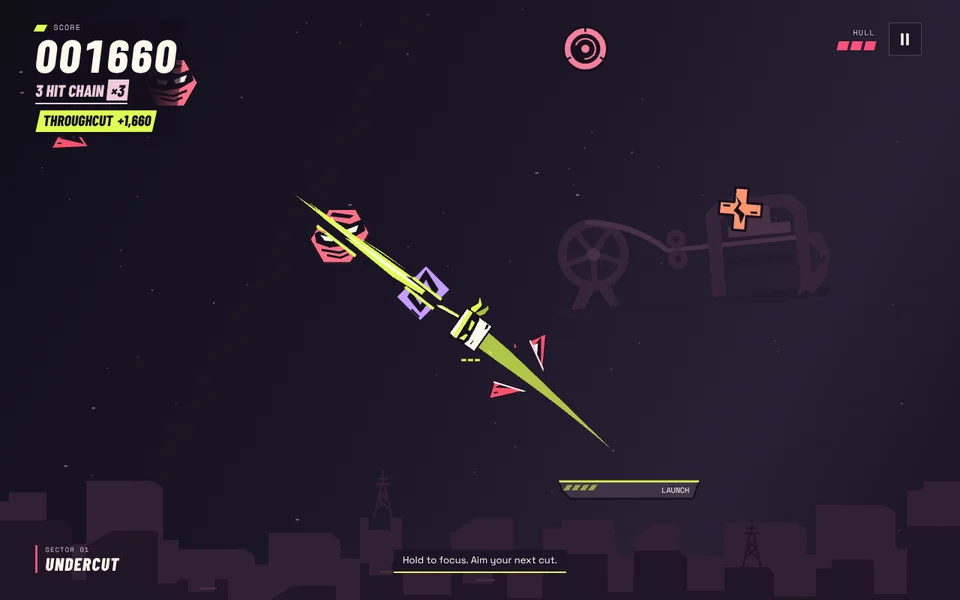
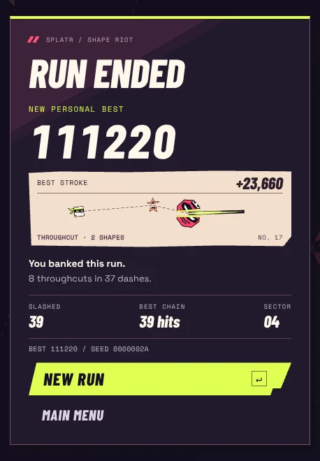

# One dash, two shapes

This audit describes the original mixed-field opening, still playable via **Options → Run opening → Full field**. For the current first run, see [the cutting room](cutting-room.md).

In the previous game the best reason to hit a Fang was to get another dash. Now there’s also a reason **not to use it yet**. Cut a second full-size shape on the same launch and the blade tears forward from that contact. A Bastion that would cost two fresh cuts can be split from a distance. If the line is dangerous, redirect early: you keep the timed chain but give up the Throughcut.

## What “slop” meant in this review

Not “this image looks AI-generated.” The test was: **does the art describe the action, does the UI tell the truth, and can the player use the difference between two effects?** Procedural layout, simple polygons and a familiar Start button aren’t defects in themselves.

| Research | What it changed here |
| --- | --- |
| Bazzaz & Cooper, *Player Perceptions of Generative AI in Games*, analyzed 508,192 English Steam reviews and coded 600 in depth. Reviewers described visual continuity errors as a lack of care; other objections were ethical, independent of quality. These are players’ perceptions, not a way to determine authorship from a screenshot. [1](https://arxiv.org/html/2608.11539v1#S4.SS3) | Look for continuity errors we could actually reproduce: a shell losing its damage when split, or a celebratory message describing a repair that didn’t happen. |
| Wadinambiarachchi et al., CHI 2024: in a 60-person visual ideation task, AI-assisted participants fixed more on the initial example and produced less varied ideas than the baseline. Not a game-art quality rating. [2](https://arxiv.org/abs/2403.11164) | Instead of trying another palette on the same eclipse and orbiting shapes, compose the title around a specific event from this game. |
| *Co-Constructed or Constrained?*, CHI 2026: 16 professional UX designers produced 32 screens with and without FigmaAI. The assisted workflows accelerated setup but the resulting screens tended to converge visually and structurally. Two time-boxed UI tasks, not a live HUD experiment. [3](https://dl.acm.org/doi/10.1145/3772318.3790758) | Ask what this particular report is for. A row of collection icons can appear in almost any game; a print of the player’s most valuable stroke cannot. Keep predictable navigation, not interchangeable contents. |
| Kao, *The effects of juiciness in an action RPG*, compared four versions with 3,018 participants. Both no juice and extreme juice did worse than medium/high on the outcomes studied. It doesn’t supply an ideal number of freeze frames for a slasher. [4](https://doi.org/10.1016/j.entcom.2020.100359) | Spend the stronger visual and sound accents on material breaking, danger, and a move worth setting up. Don’t shake the camera for issuing an input. |
| Pichlmair & Johansen, *Designing Game Feel*, distinguish tuning physicality, amplifying event significance, and supporting player intention. This is a synthesis, not an experiment on SPLATR. [5](https://arxiv.org/abs/2011.09201) | Add the choice first; give it an aim cue, then an impact. Do not substitute an explosion for the choice. |

## Audit of the playable build

| Before | After |
| --- | --- |
| **The layout offered a move the rules didn’t recognize.** On old seed 42 the opening dash split a Fang and a Prism; it paid 100 + 360 chain points as if the two had been dispatched on separate launches. | Four mirrored starting lanes pair two soft targets with a plated target behind. Later line formations and moving groups offer the same opportunity; other routes stay open. Holding focus shows **one notch, then two** where the aimed arc passes near cuttable shapes. These are sights, not guaranteed hits or steering. |
| **Art lost the action between frames.** Both offcuts started at the same position during hit-stop, and fragments called the default full-health enemy drawing. The manual put a dashed ring around *every* specimen, even a Fang that attacks in a line. | Offcuts open immediately along the real strike and keep the pre-hit plate state. Surviving armor keeps a fault on the angle of impact. Each manual plate depicts its own bearing, split, beam, ring, pull or volley. The title is a torn two-ink poster: two direct victims, then the plated one farther along the blade. Its slit is the same drawing used by the attack. |
| **Everything sounded and moved like a kill.** An empty dash kicked the camera; a small Fork offspring and a Crown both got two stop ticks, the same camera kick and nine sparks. An airborne pointer-down played the focus swell even for a tap. | A whiff has a propulsion cue but no hit-stop, haptic or kick. A chip gets **0** stop ticks, a paper body **1**, a broken Bastion **3**, a Crown or Throughcut **4**. Armor that survives gets a short clack and stays on screen. Simultaneous contacts take the strongest stop and contact cue rather than stacking them. A focus swell requires a held focus. With motion off, the static split, slit and receipt survive; shake, flying debris and haptics don’t. |
| **The UI reported noise and sometimes a falsehood.** In a busy Crown frame, three point labels and a large “hull repaired” banner competed with sight lines. `repair` was emitted even at three hull. After banking a 42-hit chain the report told you to get six. | No floating score text. The score, multiplier, Overdrive timer and one short stroke receipt share an edge. A crack lives on the shell, warnings at their sources; the hull message requires an actual increase. The run slip shows the best **single dash by points**, with actual target positions and the direction of the forward cut. No kills means no invented highlight. |

Kept: the scarfed cube, eight enemy silhouettes, local edge pips, interruptible attacks, safe first input, fixed-step interpolation, and direct Start / Resume / New run actions. None needed replacing to make the new choice work.

## What we checked

- **Same seed, different decision.** In the new build, seed 42: hold course → Fang 100 + Prism 360 + flat Throughcut bonus 300 + Bastion 900 = **1,660 in one dash**. Redirect at the Prism immediately after hitting the Fang → **460 in two dashes**; the Bastion still has one plate. Both keep the timed chain. `test/stroke.test.js` runs both through actual collision and scoring code. A shear is a forward sensor query, not a radial clear: no off-axis hits, extra waves from offspring, or double-dipping on armor.
- **Not a one-seed demo.** In 120 opening seeds the two marked targets were on screen in phone, embedded and landscape views, and the first launch really sheared the rear Bastion. The test checks the bodies that died, not just the guide dots.
- **Beyond the opening.** In a built-HTML run driven by real mouse events (seed 42), the test chose visible lines or redirected when none appeared. **Eight Throughcuts, 39 kills, sector 04, 111,220 points in 37 dashes.** Its best stroke was worth 23,660. This is one scripted route, not a score distribution for players.
- **Presentation in play.** Checked a touch launch and its receipt at portrait DPR 2 with reduced motion, the manual and run slip at 844×390, keyboard focus and a zero-shot retry. The HTTP preview test clicks Start and scores a Throughcut in a scripts-only iframe with origin checks on. The offline build needs no art or font requests.

**What’s not measured:** enjoyment. A useful next playtest is to watch first-time players after the staged opening, without explaining the notches. Can they deliberately set up another Throughcut, tell a plate crack from a kill with audio off, and explain when they would abandon a line? If they only fire it by accident, revise the sight picture or the encounter spacing before adding more effects.
