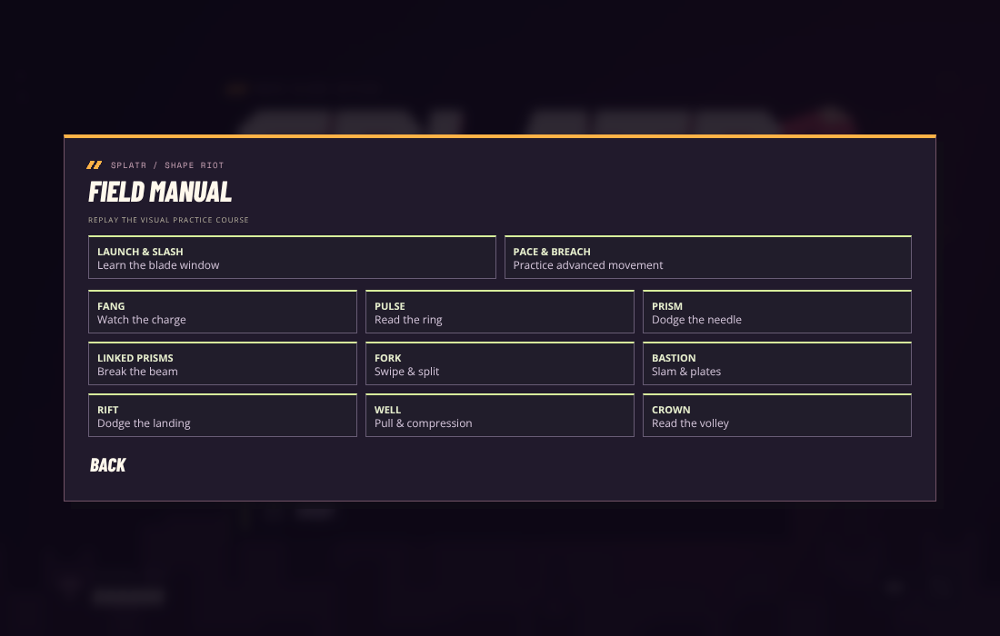
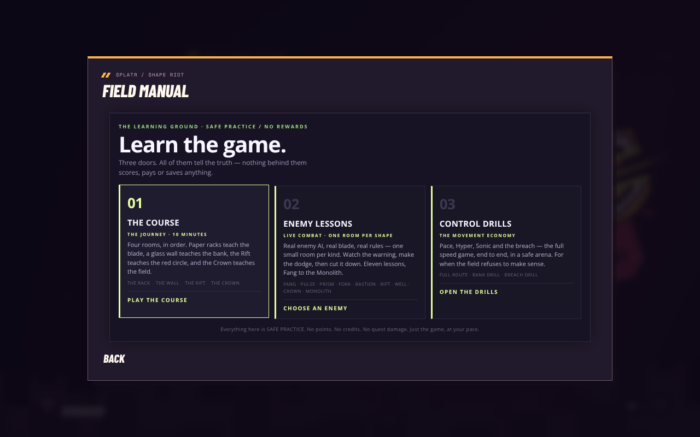
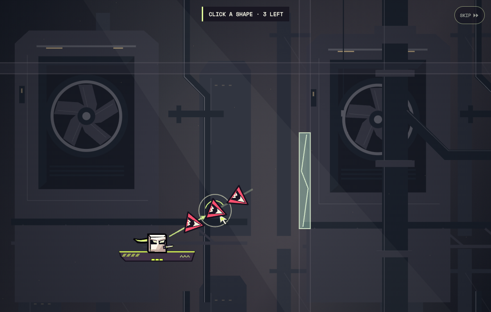
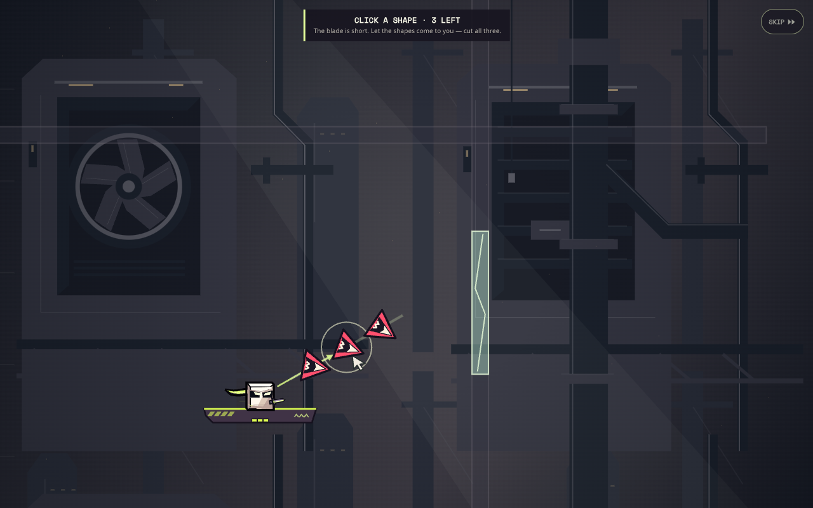
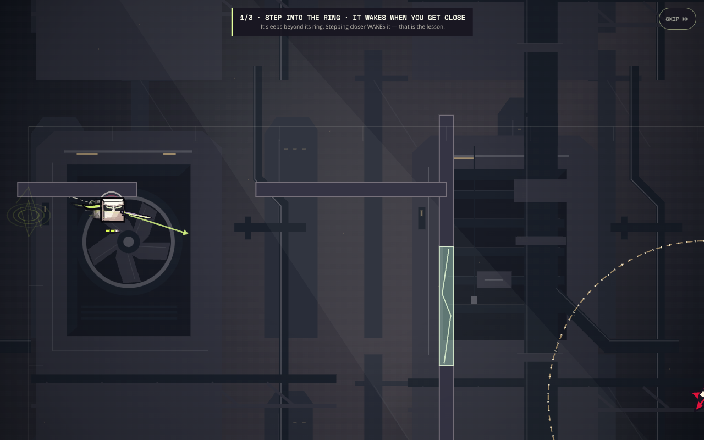
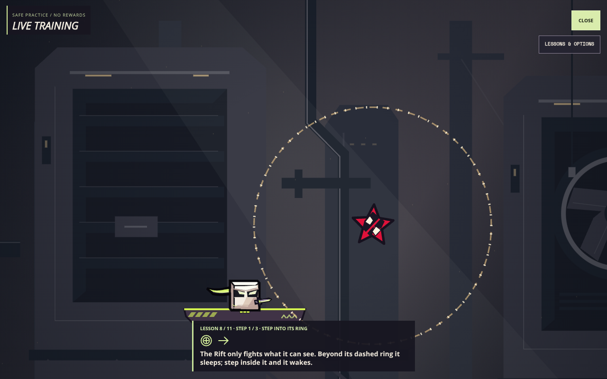
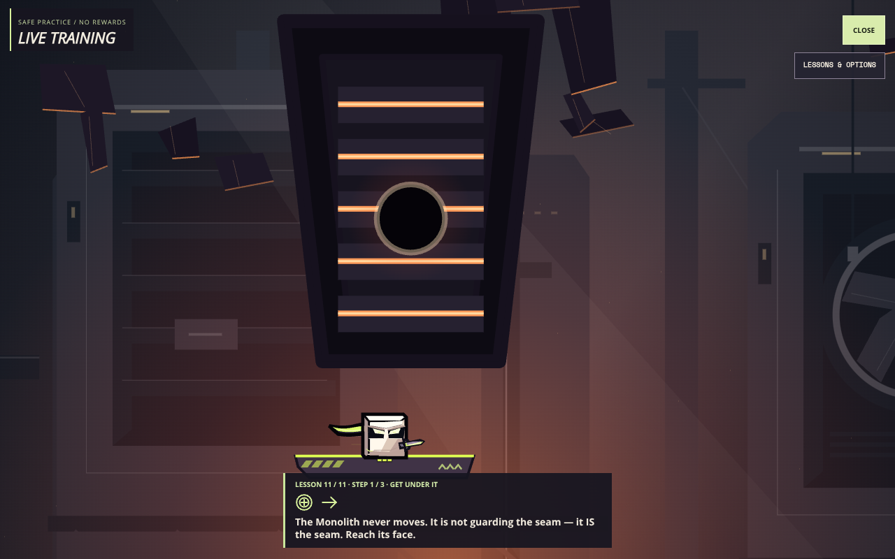
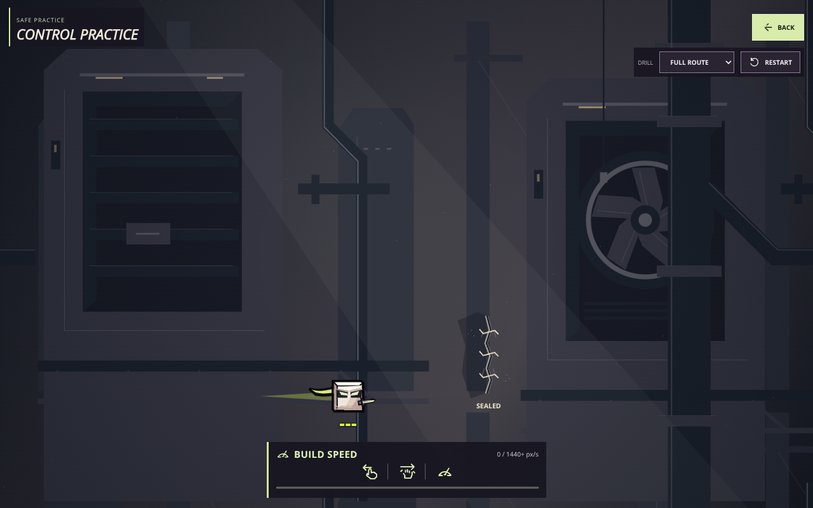
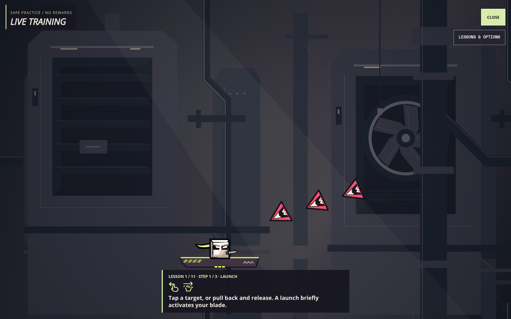

# THE LEARNING GROUND — CHUNK 5

The training experience, redesigned from the front door inward. The old
Field Manual was a wall of eleven buttons that all started the same
four-room course, the quest board's training buttons were wired to
nothing, and the course itself told a new player *what* to do without ever
saying *why* — worst of all in the Rift room, where the game said
**"WAIT FOR THE RED CIRCLE"** while nothing could possibly happen, because
the Rift only fights what it can see and never wakes until you step close.

|                     | Before                                            | After                                        |
| ------------------- | ------------------------------------------------- | -------------------------------------------- |
| Field Manual        | 11 buttons, every one a different label, all starting the same course | **The Learning Ground**: three truthful doors (Course / Enemy Lessons / Control Drills) |
| Course banner       | Instruction only (`CLICK A SHAPE · 3 LEFT`)       | Instruction + a **why-line** per room (`The blade is short…`) |
| Rift room objective | `1/3 · WAIT FOR THE RED CIRCLE` — a wait that never comes | `1/3 · STEP INTO THE RING · IT WAKES WHEN YOU GET CLOSE` |
| The sleeping Rift   | Invisible rule — attacked from 820px, body slid at you while dormant | **Dashed wake ring** drawn around dormant rifts (world units), rift holds its ground until woken |
| Idle player         | Same instruction forever                          | After ~6.5s of no objective progress the banner escalates: **`GO — …`** directive |
| Rift lesson         | opened mid-attack (`WATCH THE WARNING`), assumed the fight already started | opens on the wake-up: **`STEP INTO ITS RING`** |
| Monolith lesson     | — (did not exist)                                  | **`MONOLITH / THE LANDLORD`**: SHATTERED room, banked OVERCHARGED cuts |
| Quest board training buttons | dead (dialogs existed in source, never rendered) | wired: **Learn → Field Manual**, plus **drills** and **enemy lessons** |







## 1. What the player said

Verbatim, about the old training:

> "add more visuals guidance and show through using visual story telling and
> it's current ambigue and new player doesn't know why the wave isn't
> starting. like the rift system at the start it's shit. i don't know why to
> reach rift to start."

Reading the rooms with that in hand, the failure is precise:

1. **The Rift room was a dead end with a straight face.** The banner said to
   wait for the red circle; the circle only comes after the Rift wakes; the
   Rift only wakes when the player is within attack range. Nothing on screen
   said *why*, and nothing slept visibly — a dormant shape cannot communicate
   that it is dormant.
2. **The whole surface was fake work.** Eleven buttons, eleven names, one
   behavior (`start({learningGround:true})`). A player could spend ten minutes
   "choosing a lesson" that never existed.
3. **Instruction without stakes, reason without story.** Every banner line
   was a verb, never a *because*.
4. **The new-content path was sealed shut**: the two live dialogs (LIVE
   TRAINING, CONTROL PRACTICE) were instantiated in source and shown
   nowhere.

## 2. The Learning Ground — `src/training-hub.js` + `manual()` in `src/main.js`

The doors are data; the page is a factory; the wiring lives in `main.js`.

| door | tag | opens |
| ---- | --- | ----- |
| **01 THE COURSE** | THE JOURNEY · 10 MINUTES | `start({learningGround:true})` — the four rooms, in order |
| **02 ENEMY LESSONS** | LIVE COMBAT · ONE ROOM PER SHAPE | `createTeachingUI` — all eleven live lessons |
| **03 CONTROL DRILLS** | THE MOVEMENT ECONOMY | `createControlPracticeUI` — pace / Hyper / Sonic / breach |

Rules the hub holds (`training-hub.js`, tested in `test/chunk5.test.js`):

- Every door carries a **name, a tag, a body, a detail strip and a CTA** —
  marketing copy is not allowed to overclaim. The lessons door says what is
  actually inside: eleven lessons, Fang to the Monolith.
- A door with no callback renders **disabled with its reason** (`NOT
  AVAILABLE`) — never a button that fails silently.
- `SAFE PRACTICE / NO REWARDS` is on the tin: nothing behind these doors
  scores, pays, or saves anything.

`main()` now builds the hub (`.visual-manual`), instantiating both dialogs
once at boot and wiring them into the hub, the quest board
(`practice`/`teaching`/`startTutorial`), and `#tutorial-objective`'s
why-line. The old `REPLAY THE VISUAL PRACTICE COURSE` wall of buttons is
gone.

## 3. The Rift, fixed

This is the heart of the complaint, and it is fixed at three levels:

**The rule is now visible.** `src/art/splatr-art-engine.js` draws a
dashed **attention ring** around any enemy that carries `wakeAt` while it
is in `idle` mode — world units, before the radius scale, so the ring is
always the honest wake radius. The course Rift uses `wakeAt: 330`; the
LIVE TRAINING lesson uses `wakeAt: 200`, matching its own copy. Other
enemies have no `wakeAt` and draw nothing.

**The rule is now enforced, not just displayed.** `src/slasher.js` gates
the closing lean on the same condition as the attack: a sleeping shape
holds its ground. (This also closes a slow failure the old code had:
the "sleeping" Rift crept into the player anyway, woke mid-walk, and
attacked before any warning was legible.)

**The reason is now on screen.**

```
1/3 · STEP INTO THE RING · IT WAKES WHEN YOU GET CLOSE
It sleeps beyond its ring. Stepping closer WAKES it — that is the lesson.
```

The second line is the **why-line** (`#tutorial-objective-why`, written by
`tutorialWhy()` in `src/visual-tutorial.js`), and it reads the **live
simulation**, not a script:

| Rift state (live)            | why-line |
| ---------------------------- | -------- |
| idle, beyond the ring        | `It sleeps beyond its ring. Stepping closer WAKES it — that is the lesson.` |
| `tell`                       | `The red circle is its one dangerous moment. Be outside it.` |
| dodged, two targets remain   | `Two targets remain — cut the Rift, then the Fang.` |
| stage 0 / stage 1            | `The blade is short. Let the shapes come to you — cut all three.` / bank line |

Confirmed live in Chromium: crossing the ring flips the why-line to the
tell text in the same frames the Rift switches to `tell` — one readout,
two honest faces.



The **banner also escalates**: if objective-relevant progress does not
change for `STALL_TICKS = 390` consecutive ticks (~6.5s at 60Hz), the
banner switches from instruction to directive — `GO — STEP INTO THE RING,
THE CIRCLE COMES NEXT`, with equivalent directives for the other rooms,
the Crown and the bank. Stall is per-room state tracked by a progress
signature (rack count / bank+gate / rift mode / crown hp); any objective
movement resets it. It is a directive, not a fail-state — nothing is
lost, skipped, or scored.

## 4. The course, room by room

Each room now has one line for what to do and one for why the room exists
(`TUTORIAL_LINES`), surfaced through the same banner as the objective:

| room | action | why |
| ---- | ------ | --- |
| THE RACK | `CLICK A SHAPE · N LEFT` | The blade is short. Let the shapes come to you — cut all three. |
| THE WALL | `BOUNCE OFF THE GLOWING RIGHT WALL` | Speed is the whole game. Bank off the marked wall. |
| THE RIFT | `STEP INTO THE RING …` | It only fights what it can see. Step close — when the red circle comes, be outside it. |
| THE CROWN | `SLICE THE SHAPE · N HITS LEFT` | Three plates stand between you and the field. |

Banner markup changed to `<span id="tutorial-objective-text">…</span><small
id="tutorial-objective-why"></small>` — the old `setText()` wrote
`textContent` onto the container, which silently destroyed the why-line on
the first update (caught in browser QA; fixed and re-verified).

## 5. The lessons dialog — wired for the first time

`LIVE TRAINING` (`src/teaching-ui.js`) existed in source since the teaching
redesign and was rendered nowhere. It is now reachable from the hub and
from the quest board. Two lessons are new or rewritten:

**RIFT / STAR (lesson 8)** — rewritten around the wake-up, because that is
the entire lesson:

| step | label | teaches |
| ---- | ----- | ------- |
| 1 | `STEP INTO ITS RING` | the dashed ring is its gaze; beyond it, it sleeps |
| 2 | `WATCH THE WARNING` | the dashed circle is where it will blink and strike |
| 3 | `TRY IT` | interrupt before the blink, or let it pass |

The lesson observes the approach within 200px (matching its drawn ring)
before the tell ever appears. The old mid-attack opener is gone.

**MONOLITH / THE LANDLORD (lesson 11)** — new, in a live torn arena:

| step | label | teaches |
| ---- | ----- | ------- |
| 1 | `GET UNDER IT` | it never moves; you come to it |
| 2 | `BANK THE RAILS` | ordinary cuts chip 1 hp; a banked OVERCHARGED cut (stage 4) takes a plate |
| 3 | `FIVE PLATES` | each OVERCHARGED cut takes one; ten ordinary cuts still fell it |

The scene sets `arenaMode: 'SHATTERED'`, the kinetic ladder to 1, and seats
the Monolith **pinned** at `[30, -280]` — same landlord as the real
SHATTERED endgame, no rewards, teaching arena flag on.




## 6. The drills dialog — wired, unchanged content

`CONTROL PRACTICE` (`src/control-practice-ui.js`) was the second dead
dialog. It is reachable from the hub (`03 CONTROL DRILLS`) and the quest
board. Its content is unchanged — pace, Hyper, Sonic and the breach in one
safe arena — and that is the point: it was never the broken thing; it was
an honest drill standing inside a doorway that had no door.




## 7. Evidence

- **Tests: 712/712** (703 baseline + 9 new in `test/chunk5.test.js`: hub door contracts, every `TUTORIAL_LINES` room, `tutorialWhy` live-rift reads, stall directives incl. Crown/rack/bank/rift, Monolith lesson existence + SHATTERED scene + end-to-end win).
- `test/enemy-zones.test.js` now wakes the Rift through its ring before expecting tells — the same protocol the lesson teaches.
- `test/teaching.test.js` — Rift lesson starts on `approach`; 8/8.
- **Chromium QA (headless SwiftShader)**, run end-to-end on the final build — hub renders, all three doors open real surfaces with zero console errors; course room 0 shows the why-line live; room 1 banks into `SLICE THE GLOWING GATE`; the gate is broken with a **physics-honest slingshot launch** (see below) and the course advances to room 2; room 2 shows the approach banner + why-line + the dashed ring; crossing into the ring flips the Rift to `tell` and the why-line with it (`It sleeps beyond its ring…` → `The red circle is its one dangerous moment. Be outside it.`); stall directive (`GO — …`) observed live; both dialogs select and render every lesson (11 lessons, Fang to the Monolith); Monolith lesson spawns in the torn room.
- **Before shots** were built from the base commit (`3c522a2`, pre-chunk-5); the training-relevant diffs since then are all chunk-5, so the "before" is genuine.
- **Before/after pair for the hub and the course** is real and committed in `docs/img/`. The **Rift-room before shot was not capturable**: the base build has no `__riot` debug handle, and the base's Rift room is exactly the ambiguity this chunk fixes — the before behavior for that room is described in §1, and the after shot is real.

### The gate-break lesson (worth recording)

Getting the headless course QA past gate 1 took real debugging and is
recorded here so nobody re-learns it:

- Raw position teleports (`body.position.x = …`) bypass Matter's vertex
  sync. The body's `positionPrev` still describes the old spot, so the next
  `Body.update` derives a **~150–400 px/tick velocity from the teleport
  delta itself** — the cube rockets off (observed: `-473 → -1197` in one
  poll) and tunnels straight through the 30 px gate band **without the
  pair ever being evaluated**: no overlap, no `collisionStart`, no
  `gateTouch`, no break.
- Syncing `positionPrev = position` kills the rocket but leaves
  `part.vertices` and `bounds` pinned at the **pre-teleport location
  forever** — the game then renders the cube at the new spot while the
  physics still collides at the old one (observed: the cube fell through
  the gate as if it were not there).
- The only faithful teleport is `Matter.Body.setPosition`, which the game
  uses internally but does not expose. So the course QA now does what a
  player does: **pull the slingshot down, launch the cube up into the
  gate**. The swept `circle-inset` clamp stops it at the contact plane and
  the square's corners interpenetrate — which is exactly the collision the
  gate logic was designed around. One or two pulls break the gate; the
  next launch crosses the line and the course advances.
- SwiftShader ticks are slow (a room can take minutes of wall time), the
  blade decays per tick, and `waitForFunction` is the honest way to wait —
  fixed sleeps are not.

### The live wake check (final build)

The room-2 flow was verified twice on the final build. Objective timeline
from the last run:

```
room2 (park)          1/3 · STEP INTO THE RING · IT WAKES WHEN YOU GET CLOSE
                      why: It sleeps beyond its ring. Stepping closer WAKES it — that is the lesson.
                      (stall had escalated the objective to the GO — directive, why unchanged)
wake poll ~30 (7.5s)  1/3 · CLICK THE GREEN DIAMOND   (mode: tell)
                      why: The red circle is its one dangerous moment. Be outside it.
```

The why-line now re-evaluates every frame against the live simulation
(`tutorialWhy(visual, enemies)` in the render loop, cached by value) rather
only when the objective string flips, and the recover/attack states have
their own lines (`It just struck. Wait for the next circle — then be
outside it.`).

### SwiftShader ceiling

The headless renderer still refuses to capture **screenshots** once the
Rift's strike animation bursts (`Target closed` / `Protocol error`), which
is a SwiftShader ceiling, not a game defect — the same rooms play in the
shipped browser build. Screenshots in the Rift room are taken of the
approach state only; the wake → tell transition is verified via `__riot`
state snapshots and unit tests rather than pixel capture.

## 8. Files

```
src/training-hub.js         THE LEARNING GROUND — the three doors (new)
src/main.js                 manual() builds the hub; dialogs wired (hub + quest board);
                            why-line writes #tutorial-objective-why; room marker dataset
src/visual-tutorial.js      TUTORIAL_LINES (why per room), STALL_TICKS, stall escalation,
                            tutorialWhy(), stage-2 wake gating (wakeAt:330), objective copies
src/slasher.js              sleeping shapes do not close the distance (wakeAt gate)
src/art/splatr-art-engine.js  dashed attention ring for dormant wakeAt enemies
src/teaching.js             Rift lesson rewrite (approach/tell/clear); MONOLITH lesson
                            (SHATTERED scene, pinned, kineticStage 1); rift/monolith
                            observation conditions
src/teaching-ui.js          approach/charge step icons
index.html                  banner = text span + why-line small; aria-label updated
src/style.css               .training-hub* block; #tutorial-objective small
test/chunk5.test.js         9 new tests
test/teaching.test.js       Rift lesson protocol; kind set includes monolith
test/enemy-zones.test.js    Rift wake-then-tell protocol
qa-browser/chunk5-qa.mjs        course-flow Chromium QA (after; physics-honest launches)
qa-browser/chunk5-dialogs-qa.mjs dialog-only Chromium QA (after; LIVE TRAINING + CONTROL PRACTICE)
qa-browser/chunk5-manual-shot.mjs re-captures the hub shot only
qa-browser/chunk5-probe.mjs     scratch probe from the gate-break investigation
qa-browser/chunk5-before2.mjs   before-build capture (base commit)
docs/img/training-*.png     before/after screenshots
```

## 9. Not done / not claimed

- **No commit/push** — branch policy; the working tree carries chunk-4 +
  chunk-5 uncommitted.
- The **Crown room (stage 3)** banner copy is unchanged in shape; the stall
  directive exists for it (`GO — N HITS LEFT · BREAK THE PLATES`) but was
  not playtested end-to-end in this pass.
- The **rift-awake** screenshot was not capturable in headless SwiftShader;
  only the dormant/approach state is imaged.
- The wake ring renders only for enemies with `wakeAt` (the two teaching
  Rifts) — deliberate: it is a teaching device, not global noise.
- The Monolith lesson sets SHATTERED state by writing the same fields the
  SHATTERED director sets (`arenaMode`, `kineticStage`); it is a lesson
  flag, not a fake — the spawn, plates and rules are the real ones.
- Stall escalation helps the player who is stuck; it does not *start* the
  wave for them, and it never advances a room.
